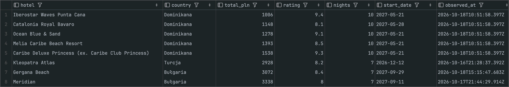
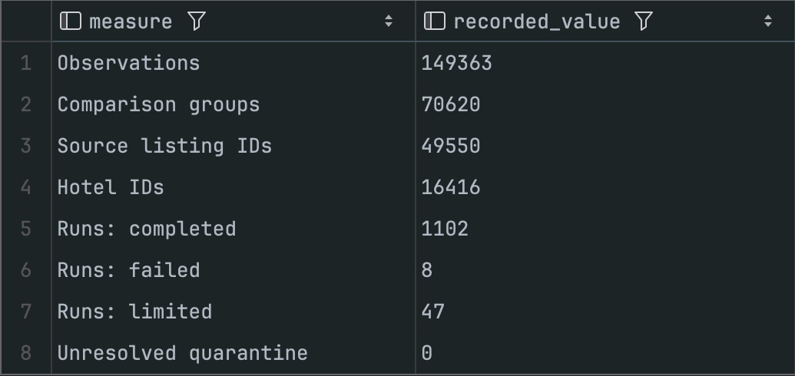

# wakacjepl-scraper

Travel offer collection and price analysis with **Bun, TypeScript and SQLite**.

[](https://github.com/SculptTechProject/wakacjepl-scraper/actions/workflows/ci.yml)

A backend learning project built around native Fetch, cursor pagination, session
handling and auditable data collection. It stores offer observations with their
source payloads, keeps price history and ranks saved variants with a transparent
price/quality baseline.

**Educational, unofficial and independent of Wakacje.pl.** Use only data and
sessions you are authorized to access, respect the service's terms and request
limits, and stop when access is denied. There is no authentication, CAPTCHA,
TLS or rate-limit bypass.



*Actual local SQLite data in DataGrip. Prices were observed on 16–18 October
2026; this is a historical sample, not a live availability check.*

## What is implemented

- Native Fetch client with typed methods, query parameters, JSON/text responses,
  timeouts, cancellation and separate HTTP/transport errors.
- Optional in-memory cookie jar with domain, path, expiry and Secure rules.
  Firebase installation tokens have a separate cache and refresh lifecycle.
- Sequential cursor collection across country, profile and transport scopes,
  with bounded GET retries, explicit resume checkpoints and provider partitioning.
- SQLite observation history, versioned migrations, atomic page writes and
  quarantine for invalid source records.
- Offline statistics and ranking: cheapest variants, Last Minute flights and
  quality-filtered All Inclusive flights. No trained ML model.

## Try it offline

Use Bun **1.4.3**, matching `.bun-version`. No credentials are needed for the demo
or tests.

```bash
git clone https://github.com/SculptTechProject/wakacjepl-scraper.git
cd wakacjepl-scraper
bun install --frozen-lockfile
bun run demo
bun run start --stats --db=data/demo.sqlite
bun run start --deals --db=data/demo.sqlite
```

The demo creates `data/demo.sqlite` with six **fictional** hotels and two sets of
observations. It runs the real normalization, storage and ranking code without
network requests. It refuses to overwrite an existing database; to run it again,
choose a new directory with `bun run demo --db=data/another-demo/demo.sqlite`.
The real collection database is separate: `data/offers.sqlite`.

```bash
bun run typecheck
bun test
bun run start
```

Starting with no arguments prints help and makes no requests. CI installs from
the lockfile, checks types, runs tests and exercises the offline demo on Linux.
Tests use mocked Fetch or isolated local databases and never call Wakacje.pl or
Firebase.

## The database

SQLite is accessed directly through `bun:sqlite`, with prepared statements,
foreign keys, STRICT tables and WAL. There is no database server or ORM to set up.

| Table | Purpose |
| --- | --- |
| `scrape_runs` | Query scope, timestamps, status, coverage counters and stop reason. |
| `offer_observations` | Normalized fields, integer prices, identity keys and original offer JSON. |
| `rejected_offers` | Source records that failed validation, with an auditable repair history. |

An observation, a source listing, a comparison group and a hotel are different
things. One hotel may have many dates, departures, providers, rooms and prices.

The existing local dataset was checked on **28 October 2026**:

| Measure | Recorded count |
| --- | ---: |
| Observations | 149,363 |
| Comparison groups | 70,620 |
| Source listing IDs | 49,550 |
| Hotel IDs | 16,416 |
| Runs | 1,157 |
| Completed / limited / failed runs | 1,102 / 47 / 8 |
| Unresolved quarantined records | 0 |

Observations span `2026-10-16T20:46:47.117Z` to
`2026-10-18T15:15:55.359Z`. These numbers describe one saved dataset, not total
API inventory. The database and traffic captures are deliberately excluded from
Git; the offline demo is reproducible from source.



To inspect either database in DataGrip, add a **SQLite** data source and select
its file. The schema is in `main`. Open [docs/queries.sql](docs/queries.sql) for
read-only examples covering totals, latest offers, run coverage, price history
and quarantine. See [the data model](docs/data-model.md) for field semantics.

## Collect authorized data

```bash
cp .env.example .env
```

Set `WAKACJE_AUTHORIZATION` locally to the raw value from your authorized backend
session. Do not add a `Bearer` prefix. `WAKACJE_DEVICE_ID` is optional; a UUID is
generated when omitted. Backend authorization is separate from Firebase's
installation token; offer collection does not need Firebase configuration.
No credentials or cookie values belong in source control or screenshots.

Start with a bounded sample:

```bash
bun run start --collect --profile=all --max-pages=2 --page-size=100
bun run stats
bun run deals
```

For a deliberate broader collection:

```bash
bun run scrape
bun run start --collect --by-country --profile=all-inclusive
bun run start --collect --profile=all --offer-type=2
```

`scrape` enumerates known countries × three profiles × published transport
modes, follows returned cursors and has no default page cap. CLI pacing is at
least one second between pages; increase it with `--delay-ms`. `--max-pages`
limits each query scope. Press Ctrl+C to cancel; committed pages remain stored.

`--resume-since=<ISO-timestamp>` resumes eligible country scopes from the same
recorded batch. Use the UTC start time printed by that batch, rather than a
made-up checkpoint. Without this option, collection appends new observations.
`--offer-type=2` is the observed tour filter and applies to unpartitioned collection.

| Profile | Query |
| --- | --- |
| `all` | No promotion or catering constraint. |
| `last-minute` | `promotionList=[1]`. |
| `all-inclusive` | `cateringList=[1]`, independently of Last Minute. |

## Design notes

```text
src/http/       Native Fetch transport, HTTP errors and types
src/session/    Firebase installation token lifecycle
src/services/   Wakacje request and response contracts
src/offers/     Collection scopes, normalization and ranking
src/storage/    SQLite history, migrations and query access
src/main.ts     CLI workflows and dependency composition
examples/       Offline synthetic dataset
```

The generic HTTP client knows nothing about travel offers. Domain responses
enter as `unknown` and are validated before persistence. Cookie rules are
handled by `tough-cookie`, the only runtime dependency; maintaining a partial
cookie parser would add risk without helping the learning goal.

Generic requests never retry automatically. Only the listing GET workflow has
bounded retries for transient failures; creation POSTs are never blindly replayed.
Redirects are manual and request URLs must stay on the configured origin, so
configured credentials cannot silently follow a redirect to another host.

[Architecture and transport decisions](docs/architecture.md) ·
[Data model and coverage rules](docs/data-model.md) ·
[SQL examples](docs/queries.sql) · [Contributing](CONTRIBUTING.md)

## What the data can tell you

The source can report changing totals, return fallback items outside requested
filters and truncate broad searches at an observed result window. The collector
records `limited` and `failed` runs explicitly. Country/provider partitioning
improves coverage; it does not prove exhaustive collection.

Ranking compares recorded variants and requires at least five other hotels for
a peer benchmark. A lower price than that sample is not a historical discount.
Missing room identity also limits comparisons across time. The saved prices are
indicative and reading the database does not recheck availability.

The next useful steps are stronger variant identity, repeated observation
batches and a time-based evaluation dataset. A future price model should beat
the current median baseline before adding complexity. There is no ML training
or generated “deal” ground truth in this repository.

## License

[MIT](LICENSE) for the source code. Third-party offer content and service names
remain the property of their respective owners; the local dataset is not
included or licensed by this repository.
