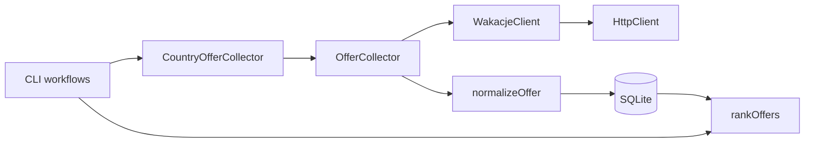

# Architecture

The application keeps transport, source-specific requests, collection, and local
analysis separate. It uses Bun, native Fetch, and `bun:sqlite`; `tough-cookie` is
the only runtime dependency.

| Module | Responsibility |
| --- | --- |
| `index.ts` / `src/main.ts` | Parse options, load local configuration, compose dependencies, report safe errors. |
| `src/http/` | Build URLs, merge headers, serialize JSON, read responses, enforce timeouts, expose HTTP failures. |
| `WakacjeClient` | Encode observed query parameters and validate listing/catalog response envelopes. |
| `OfferCollector` | Follow opaque cursors, pace GET requests, validate records, persist observations and quarantine invalid items. |
| `CountryOfferCollector` | Enumerate country/profile/transport scopes, use explicit resume checkpoints, partition limited scopes by provider. |
| `normalizeOffer` | Validate unknown source records and produce normalized fields and keys. |
| `OfferRepository` | Manage SQLite migrations, prepared statements, transactions, history, and audit records. |
| `rankOffers` | Rank saved variants and calculate a transparent peer-price baseline. |

## Transport and sessions

`HttpClient` handles JSON or explicitly selected text responses. Empty bodies
produce `undefined`. Non-2xx responses become `HttpError`; network errors,
timeouts, and malformed successful JSON remain distinguishable. A response
generic describes the expected TypeScript shape; it does not validate input.
Source payloads enter domain code as `unknown`.

Timeouts cover Fetch and body reading, and combine with caller cancellation.
Requests must use the configured origin, embedded URL credentials are rejected,
and redirects require an explicit caller decision. Default headers therefore
cannot be silently forwarded to another origin.

An optional shared cookie jar stores `Set-Cookie` values in memory and attaches
eligible cookies to subsequent requests. Cookie rules belong to `tough-cookie`,
not a handwritten parser. An explicit `Cookie` header takes precedence.

`FirebaseInstallationsSession` is independent: Firebase's JSON `authToken` and
`refreshToken` are not HTTP cookies. The session caches and refreshes its own
installation token in memory. It is not used as the Wakacje backend's
Authorization value. Offer collection does not require Firebase configuration.
Credentials remain in ignored local configuration, outside offer records.

## Collection behavior

Listing reads are sequential. CLI pacing is at least one second between pages,
with page sizes up to 100. Returned cursors are treated as opaque values; repeated
cursors and repeated visible pages stop the run instead of looping indefinitely.

Only the collection GET workflow retries: HTTP 429, 500, 502, 503, 504 and native
`TimeoutError`, at most three retries after the initial attempt. `Retry-After` is
honored, with a minimum one-second wait; the default backoff is 2, 4, and 8
seconds. Cancellation interrupts requests and waits. The generic HTTP client and
Firebase POST requests do not retry automatically.

Country collection combines catalog IDs with IDs already observed in stored
records. Each country/profile/transport combination has its own run. A scope
that reaches the observed API window or exhausts retries can be split once by
known provider IDs. The original scope remains in the audit trail. This improves
coverage without treating partitioning as proof that every offer was collected.

`--resume-since` explicitly reuses eligible terminal checkpoints from the same
batch and query shape. Without it, collection appends new observations. Failed
runs and deliberately page-limited samples are not resume checkpoints.

## Storage and analysis

SQLite keeps append-only observations with normalized columns for queries and
the original public offer JSON for audit. Valid observations from a page are
committed in a transaction; invalid items are stored separately in quarantine.
Committed pages survive a later request failure. WAL and a busy timeout support
local collection alongside database inspection.

Offline `stats` and `deals` workflows need neither credentials nor network access.
The ranking is a deterministic baseline, not a trained model. Future ML work
should first establish a prediction target and variant identity, then use
time-based validation and compare against that baseline.

See [the data model](data-model.md) for identity, coverage, and ranking limits,
and [read-only SQL examples](queries.sql) for DataGrip inspection.
