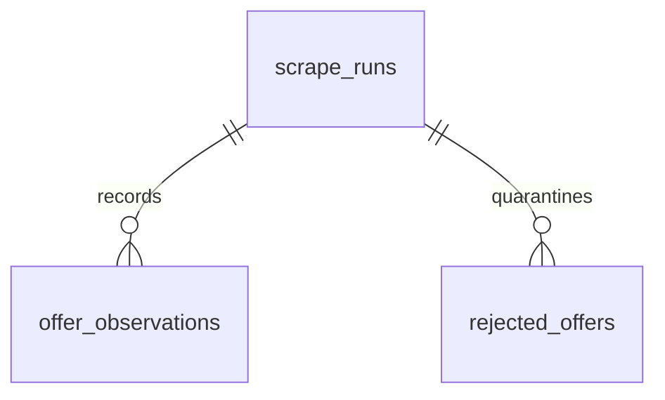

# Data model

The database records **observations of travel offers**, not a complete inventory
or guaranteed live booking prices. It defaults to `data/offers.sqlite`; local
data and SQLite sidecar files stay outside Git.

## Tables

| Table | Stored facts |
| --- | --- |
| `scrape_runs` | Profile, query JSON, start/finish timestamps, status, ingestion counters, last retained source total, stop reason, and safe error kind. |
| `offer_observations` | Normalized listing fields, price, observation time, source URL, run reference, identity keys, and original public offer JSON. |
| `rejected_offers` | Invalid source JSON, run reference, page/item position, observation time, rejection reason, and optional resolution timestamp. |

Foreign keys link observations and quarantine records to their run. Tables use
SQLite `STRICT` mode, JSON validity checks, and numeric constraints. Schema
versions use `PRAGMA user_version`: v1 introduced the three tables, v2 added
quarantine resolution, and v3 added reported totals and stop reasons. Supported
older versions migrate transactionally; unknown future versions are refused.

No Authorization headers, cookies, or Firebase tokens are stored with offers.

## Identity and history

| Field | Meaning |
| --- | --- |
| `source_id` | Listing ID provided by the source; distinct from `hotel_id`. |
| `snapshot_key` | SHA-256 of the source ID and opaque source hash. Unique within a run. |
| `comparison_key` | SHA-256 of visible variant attributes, excluding price and source hash. Used to select the latest observation. |
| `hotel_id` | Source hotel ID; one hotel can have many dates, departures, rooms, providers, and prices. |

The comparison key includes source/hotel IDs, provider, departure, dates, nights,
catering, room ID, party size, currency, and price type. Transport mode remains
in raw JSON and is used explicitly by ranking cohorts; it is not a separate
component of the current comparison key. Source IDs and missing room IDs do not
establish permanent package identity. A price change in a group is therefore not
proof of a discount on an identical package.

`UNIQUE(run_id, snapshot_key)` suppresses duplicate snapshots within one run.
Later runs append history even when the price is unchanged. Latest selection
orders by canonical UTC `observed_at`, then database `id` to break ties.
Observations, comparison groups, source IDs, and hotels are different counts.

## Normalized values

- `price_minor` stores the two-decimal minor-unit representation; PLN amounts
  are grosz. `currency` remains separate. The supported source price type is
  `total`, in the query's party context: two adults and no children.
- `start_date` and `end_date` are validated calendar dates. `nights` comes from
  the advertised stay, not a subtraction of flight dates. Zero-night trips can
  be stored but are excluded from per-night ranking.
- Missing ratings and hotel categories remain `NULL`. Source categories such
  as 5.5 or 6 are preserved rather than capped at five.
- Missing country ISO codes become an empty `country_code`, while the country
  name is preserved. Malformed provided codes are rejected. Empty room IDs
  become `NULL`.
- Actual country, catering, and transport are source facts. Query/profile
  labels never replace them. Transport is read from `raw_json` fields
  `transport.id` and `transport.unifiedName` without guessing missing modes.

## Query context and coverage

| Profile | Promotion filter | Catering filter |
| --- | --- | --- |
| `all` | `promotionList=[]` | None |
| `last-minute` | `promotionList=[1]` | None |
| `all-inclusive` | `promotionList=[]` | `cateringList=[1]` |

Profiles overlap and describe requested filters. Observed backend responses
included fallback offers with `meta.total=0`, and occasional country mismatches.
Use actual item fields when selecting All Inclusive, flights, or destinations.
Do not sum profile totals as a count of distinct offers.

| Run status | Interpretation |
| --- | --- |
| `running` | Created but not finalized. A stopped process can leave a stale row in this state. |
| `completed` | Reached an empty terminal page or end cursor without a detected source-total shortfall. Applies to this query only. |
| `limited` | Stopped at `max-pages`, an observed `api-window`, or `count-mismatch`. |
| `failed` | A request, validation, repeated-page/cursor check, or cancellation ended the run. Committed observations remain available. |

The source total can change during pagination, is not an inventory guarantee,
and can conflict with returned fallback records. Runs retain reported totals
separately from received, inserted, and rejected counts. Broad listing checks on
2026-10-16 exposed an approximately 10,000-result window; country, transport,
and provider scopes reduce its impact without proving exhaustive coverage.
Larger requested page sizes also returned misleading empty data, so the
collector accepts only the verified range of 1–100.

Run counters are finalized when collection ends. They can lag committed rows in
an unfinished run. Explicit quarantine recovery appends valid observations with
their original JSON and observation time, marks the rejection resolved, and
preserves historical ingestion counters. Query actual observation rows for the
current stored count; `rejected` in CLI statistics counts unresolved records.

## Ranking and future analysis

`deals` selects the latest recorded variants with non-past departures, positive
PLN totals for two adults without children, and at least one night. Separate
views select Last Minute flights and All Inclusive flights with rating ≥8 and
source hotel category ≥4. Listing prices are indicative and observations may be
old; reading the database does not recheck availability.

Peer comparison uses price per person per advertised hotel night. Cohorts match
country, catering, nights, category, departure, departure month, party size,
currency, price type, and transport. Each hotel contributes one median; the
candidate hotel is excluded entirely, and at least five other hotels are
required. Missing transport or insufficient peers produces no benchmark.

A positive difference means cheaper than this saved sample. It is not a
historical discount or model confidence. No ML model is trained and no synthetic
deal labels are generated. A future model needs a defined target, stronger
variant identity checks, and time/group-aware evaluation against this baseline.

See [read-only SQL examples](queries.sql) for practical inspection.
